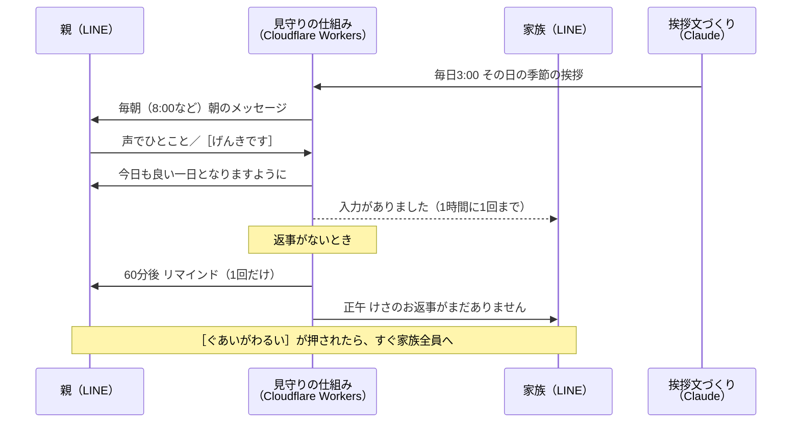

# よい一日のはじまりに

離れて暮らす親に、毎朝 LINE で季節の挨拶を届けます。親は声でひとこと返すだけです。返事がない日や「ぐあいがわるい」が押されたときだけ、家族に知らせます。

- 親は**いつもの LINE だけ**で使えます。新しいアプリも、覚える操作もいりません。
- 家族は「ようす」と送れば、いつでも今朝の様子を確かめられます。
- **無料**で動きます（LINE 公式アカウントの無料プラン、Cloudflare の無料枠）。
- 作り方はすべて公開しています。**エンジニアでなくても、Claude Code に「導入を手伝って」と話しかければ、自分の家族用に導入できます。**

> Built with Claude: Japan 2026 の応募作品です。作者（エンジニアではありません）が、自分の母（79歳）と義母（84歳）のために作り、11/5 から実際に使っています。

---

## どう動くか



### 親の画面

- 朝のメッセージ：「おはよう。立冬が近づき、朝晩ぐっと冷えてきましたね。」のような季節の挨拶と、［😊 げんきです］［😢 ぐあいがわるい］のボタン。
- 声、文字、スタンプ、写真、ボタンのどれで返しても「返事」になります。正午より前の返事には「今日も良い一日となりますように」と返します。

### 家族が使える言葉

| 言葉 | できること |
|---|---|
| ようす | 今朝の送信・返事の時刻と方法、最近の入力、この7日間の記録 |
| おやすみ ／ さいかい | 旅行や入院のあいだ、朝のメッセージを休む／再開する |
| じかん | 送る時刻を変える（5:00〜10:00） |
| なまえ | 親の呼び名を変える |
| しょうたい | 家族や親を招待する |
| つかいかた | 使える言葉の一覧 |
| メンバー（管理者） | 登録者の一覧と削除 |

家族の画面の下には、［ようす］［おやすみ］［じかん］［つかいかた］のメニューが出ます。

---

## 導入する

**いちばん簡単な方法：** このリポジトリを手元に置き、そのフォルダで [Claude Code](https://claude.com/claude-code) を起動して、こう話しかけてください。

> 導入を手伝ってください。

Claude Code が [CLAUDE.md](CLAUDE.md) の手順に沿って、LINE 公式アカウントの作成から家族の招待まで、1つずつ案内します（1〜2時間）。秘密の値（トークンなど）をチャットに貼らずに済むよう、登録はターミナルで行う形になっています。作者も、撮影用の環境をこの方法で一から作り直して確かめました。

自分で進めたい方は、[CLAUDE.md の「導入の手順」](CLAUDE.md#導入の手順) と [docs/setup-line.md](docs/setup-line.md) を順に見てください。困ったときは [docs/troubleshooting.md](docs/troubleshooting.md)。

### 費用

| 使うもの | 費用 | 目安 |
|---|---|---|
| LINE 公式アカウント（コミュニケーションプラン） | 無料 | 月200通まで。親2人・家族3人で、ふだんは月90通ほど（「入力がありました」のお知らせは別）。返事へのお礼などの「応答」は数えません。150通を超えたら、リマインドと「入力がありました」を自動で止めます |
| Cloudflare Workers・D1・KV | 無料枠 | Cron（タイマー）は1アカウント5つまで |
| 挨拶文の生成（Claude API） | 作者が負担 | 作者が公開している生成結果をみんなで使います。止まっていても、366日分の予備の挨拶文で送ります |

---

## Claude の使いどころ

1. **毎日の季節の挨拶をつくる**（[greeting-generator/](greeting-generator/)）
   毎日 3:00 に Claude がその日の挨拶文をつくります。二十四節気の前か後かを計算して伝え、「立冬の前なのに『立冬を過ぎ』と書く」ような取り違えを防ぎます。「50文字以内」「『おはよう。』で始まる」「一文だけ」「お願いや勧めを含まない」などの文面チェックに合格したものだけを使います。
2. **導入を案内する**（[CLAUDE.md](CLAUDE.md)）
   Claude Code が「導入案内係」として、エンジニアでない家族の導入を一歩ずつ手伝います。
3. **この仕組みそのものを作る**：次の章のとおりです。

---

## Claude Code との協働開発

### 開発体制

| 担当 | 役割 |
|---|---|
| 作者（エンジニアではない） | 何を作るか・誰のためかを決める（仕様書）、動作の確認、母・義母との実証、最終判断 |
| Claude Code | 設計、プログラムの作成、テストの作成、自動チェックでのエラー修正、コミット、開発記録 |

作者は先に仕様書（要件定義書兼開発仕様書）を書き、優先度（P0〜P2）と開発のステップ（⓪〜⑲）を決めました。Claude Code はその順に作り、仕様に書かれていないことや仕様を変えたほうがよさそうなことは、勝手に決めずに選択肢を説明して、作者が選びました。

### 開発の流れ

| 日 | 作ったもの |
|---|---|
| 11/4 | ⓪ 自動チェックとテストの仕組み、①〜⑨ 見守りの中心（朝の送信・返事・リマインド・正午の判定・招待・不調ボタン・デモモード）。その夜に母・義母を登録 |
| 11/5 | 実運用1日目。見つかった問題を直し、⑫ ようす、入力のお知らせ、⑪ 送信数の管理、⑩ 予備の挨拶文 366日分、⑬ Claude による挨拶文の生成 |
| 11/6 | ⑭ おやすみ・じかん、⑯ ブロックの通知、⑮ 送信失敗の再試行と管理者への通知、なまえ・メンバー・メニュー、⑰ 導入案内（CLAUDE.md）、⑱ 別の環境で一から作り直す検証 |
| 11/7〜8 | ⑲ デモ動画、この README |

ステップごとにコミットしています（[コミット履歴](https://github.com/emihira/yoi-ichinichi/commits/main)）。何をなぜそう作ったかは、[開発記録（docs/dev-log.md）](docs/dev-log.md) に残しています。

### 品質の守り方：AI が書いたコードを、AI 自身が確かめる

- **Hooks（自動チェック）**（[.claude/settings.json](.claude/settings.json)）
  - Claude Code がファイルを書き換えるたびに、型検査（書き間違いの検査）が自動で走ります。エラーがあれば Claude Code に伝わり、その場で直します。
  - コミットの前に、型検査とテストをすべて実行します。1つでも失敗すればコミットを止め、Claude Code が直してからコミットします。
- **自動テスト 112件**（[test/](test/)）
  - 見守りの判定（朝の送信・リマインド・正午・返事の種類・不調ボタンの連打）は、時刻を引数で受け取る純粋な関数にしてあります。「8:13 に遅れて起動した」「11:59:59 に返事が来た」といった場面を、実際の時刻を待たずに確かめられます。
  - 日本時間への変換、招待コード、送信数の数え方、366日分の挨拶文の文面、送信失敗時の再試行、おやすみ・じかん・メンバーなども対象です。
- このリポジトリを導入した人の環境でも、同じチェックが働きます。

### Claude Code の設計判断が役立った例

1. **二重送信の防止**：Cron（5分ごとのタイマー）が重なって2回動いても、朝のメッセージが2通届かないよう、「まだ送っていなければ、送ったと書き込む」更新が成功したときだけ送る形にしました。
2. **正午の判定の直前に読み直す**：11:59:59 に届いた返事を見落として、家族に「お返事がまだありません」と誤って知らせないためです。
3. **不調の通知が届かなかったら、記録を戻す**：記録だけ残ると、親がもう一度押したときに「さきほどお知らせしました」と返してしまいます。誰にも届いていないのに親が安心してしまうのを防ぎました。
4. **仕様を勝手に変えない**：実運用1日目、作者は「返事が来たら家族にも知らせてほしい」と感じました。Claude Code は、仕様の考え方（親の負担と通知の多さを避ける）と無料枠への影響を説明し、選択肢を示しました。作者が選んだのは「1時間に1回まで知らせ、内容は『ようす』で確かめる」形です。

### 実運用（母・義母、11/5〜）

| | 結果 |
|---|---|
| 返事があった日 | 11/7 朝の時点で、2人×3日のうち5日（うち正午より前が4日） |
| 返事の方法 | 声 2、文字 2、ボタン 1 |
| 実運用で直したこと | 夜中の登録で翌朝が送られない問題、呼び名の「さん」の重なり、招待の分かりにくさ（ボタンでコピーできるように） |
| 分かったこと | 高齢者向けスマホは、読んでいない通知を繰り返し鳴らす。母はそれを「何度も届いた」と感じていた。送った通数を自分と LINE の両方で数えていたので、余分に送っていないことをすぐ確かめられた |

（最終の結果は 11/8 に更新します。）

### 同じように作りたい人へ

- **仕様書を先に書く**：誰のために、何を、どの順に作るか。Claude Code はそれを道しるべにして作り、迷ったときに確かめに戻ります。
- **1ステップずつ、動くところを確かめる**：作ってもらったら、自分のスマホで実際に試します。実際に使って初めて分かることがたくさんありました。
- **秘密の値はチャットに貼らない**：ターミナルで直接登録する方法を、Claude Code が用意してくれます。
- **ルールを書いておく**：「専門用語は短く説明する」「仕様を勝手に変えない」「テストを書き換えて通さない」。最初に伝えておくと、最後まで守ってくれます。
- **早く本番で使い始める**：作者は開発2日目の朝から母たちに使ってもらい、そこで見つかった問題を優先して直しました。

---

## 技術の構成

- **見守りの仕組み**：Cloudflare Workers（TypeScript）、D1（データベース）、Cron（5分ごとの見守り、毎日4:00のメンテナンス）、LINE Messaging API
- **挨拶文づくり**：Cloudflare Workers、KV、Claude API（Haiku 5.5）
- **テスト**：Vitest。型検査は TypeScript

```
src/          見守りの仕組み（判定は rules.ts などの純粋な関数）
test/         自動テスト
migrations/   データベースの表
greeting-generator/  挨拶文づくり
data/         予備の挨拶文 366日分
docs/         LINE の準備、トラブル対処、開発記録
```

## プライバシー

- LINE のユーザーIDと、親が入力した内容は、自分の Cloudflare の中だけに保存します。
- 文字の返事は300文字まで、7日で自動的に消します。声は長さだけを記録し、録音は保存しません。
- 家族の名前は保存せず、表示のたびに LINE から取り出します。

## ライセンス

[MIT License](LICENSE)。誰でも自由に使い、変え、配ることができます。
